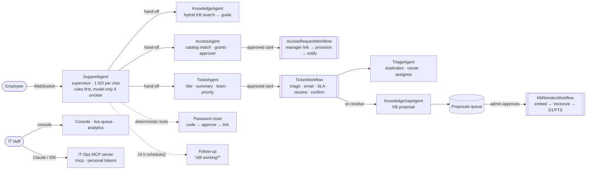

# Minocy IT Help

An edge-native, multi-agent IT self-service portal on Cloudflare's free plan. An employee describes a problem once; a **supervisor agent** routes it to the right **specialist** — fix it with the IT guides, request access to an app, reset a password, check a ticket, or raise one — and **durable workflows** coordinate the back office: triage, SLA timers, email, manager approvals and turning resolved tickets into knowledge-base improvements.

> *A supervisor agent routes, specialists act, durable workflows coordinate — every agent is a Durable Object on Cloudflare's free plan, and nothing costs money.*

## How it fits together



| Agent | Kind | Runs when | Model calls |
|---|---|---|---|
| **SupportAgent** (supervisor) | `AIChatAgent`, one Durable Object per conversation | every chat turn | ≤ 1 per turn; 0 for rule-routed hand-offs and fixed confirmations |
| **KnowledgeAgent** | facet sub-agent | new troubleshooting request | 0 when one guide clearly wins, else 1 |
| **AccessAgent** | facet sub-agent | access request | 0 when the app is named, else 1 |
| **TicketAgent** | facet sub-agent | user agrees to a ticket | 1 |
| **TriageAgent** | Agent DO, run by `TicketWorkflow` | ticket created | 1 (rules-only fallback) |
| **KnowledgeGapAgent** | Agent DO, run by `TicketWorkflow` | ticket resolved | 0–1 (rules skip, daily budget) |
| **IT Ops MCP server** | stateless MCP handler (`agents/mcp/server`) | IT staff ask from Claude | 0 |

Routing is **rules first** (`src/agents/router.ts`): 90 % of the routing eval is decided without a model call. Gemini Flash-Lite → Flash run through AI Gateway, with Workers AI as the fallback; every fallback is counted per agent in analytics.

## What's in it

- **Portal** — hero ask box and quick-action tiles that hand off to the supervisor in a **docked chat** (full-screen sheet on phones); full-page chat with history; step-by-step guide cards; editable ticket draft card; access-request card; password-reset code and confirmation cards; 👍/👎 feedback; a 24 h follow-up; *My tickets & requests*.
- **Back office** — `TicketWorkflow` (triage → team/employee email → SLA reminder at 75 % → escalation at 100 % → resolve → "Did this fix it?" → close/reopen), `AccessRequestWorkflow` (signed Approve/Reject links → real provisioning through GitHub, Okta or Jira/Confluence → verify, or a ticket if it fails), `KbReindexWorkflow`; inbound email (`help@` → ticket, `ticket+INC-…@` → comment); daily digest.
- **IT console** — live queue (WebSocket) with filters, SLA chips, ticket view with transcript and triage note, assign / start / waiting / resolve, routing & SLA settings, KB editor, knowledge-gap proposals with a diff, analytics, email Outbox, **Connect Claude**.
- **Security** — email-OTP sign-in (no passwords), server-side ownership checks on every chat and ticket, approval cards for anything with side effects, signed expiring email links (GET shows, POST acts), secrets never stored or shown to the model, hashed MCP tokens.

## Quick start

Requirements: Node 22+ and pnpm 9, a (free) Cloudflare account, and a free Gemini API key from aistudio.google.com.

```bash
pnpm install
cp .dev.vars.example .dev.vars   # set BETTER_AUTH_SECRET and GOOGLE_GENERATIVE_AI_API_KEY
pnpm db:reset                    # apply migrations + seed local D1
pnpm exec wrangler login         # once; Vectorize + Workers AI run on your (free) account
pnpm exec wrangler vectorize create it-kb --preset=@cf/baai/bge-base-en-v1.5   # once, plus metadata indexes below
pnpm kb:ingest                   # embed kb/*.md into Vectorize + local D1
pnpm dev                         # http://localhost:5173 (API + app on one port)
```

One-time Vectorize metadata indexes:

```bash
for p in "category string" "section string" "os_windows boolean" "os_macos boolean" "os_linux boolean"; do
  set -- $p; pnpm exec wrangler vectorize create-metadata-index it-kb --property-name=$1 --type=$2
done
```

Sign in with a seeded account — no real email needed locally. The 6-digit code is printed in the `pnpm dev` terminal (`[email:dev] … Your sign-in code is …`) unless `RESEND_API_KEY` is set.

| Role | Email |
|---|---|
| Employee | `ananya.sharma@minocy.example` (+7 more) |
| Manager (approves access) | `deepa.menon@…` (Finance, HR, Ops), `nikhil.bose@…` (Sales, Marketing), `lakshmi.pillai@…` (Design, Engineering) |
| IT Agent | `arjun.mehta@minocy.example` (Network), `priya.nair@…` (Hardware), `rahul.verma@…` (Software), `sneha.iyer@…` (Identity & Access), `vikram.singh@…` (Collaboration) |
| IT Admin | `admin@minocy.example`, plus your own address if you seed with `SEED_OWNER_EMAIL=you@example.com SEED_OWNER_NAME="Your Name" pnpm db:seed` |

## Use it from Claude (MCP)

IT staff open **Console → Connect Claude**, create a personal access token (shown once, stored as a SHA-256 hash), then:

```bash
claude mcp add --transport http minocy-itops http://localhost:5173/mcp --header "Authorization: Bearer <token>"
```

Tools: `listMyTeamTickets` (status / priority / overdue / assigned-to-me filters), `getTicket` (steps tried, triage note, comments), `addInternalNote`. Everything is scoped to the token owner's teams (admins: all); revoking the token cuts access immediately.

## Scripts

| Command | What it does |
|---|---|
| `pnpm dev` | Vite + Cloudflare plugin: Worker, API and React app on one port |
| `pnpm build` | Production build (`dist/`) |
| `pnpm test` | Vitest inside the Workers runtime (Miniflare) — 130 tests, no real keys or mail |
| `pnpm e2e` | Playwright end-to-end tests (starts its own `pnpm dev`; stop yours first). Uses the Edge that ships with Windows; `E2E_CHANNEL=chrome` elsewhere |
| `pnpm eval [suite…]` | promptfoo evals → [`evals/RESULTS.md`](evals/RESULTS.md): `retrieval`, `routing`, `escalation`, `ticket-quality` (LLM judge), `triage` |
| `pnpm typecheck` / `pnpm lint` | TypeScript project build / ESLint |
| `pnpm db:generate` | Generate a SQL migration from `src/db/schema.ts` |
| `pnpm db:migrate` / `pnpm db:seed` / `pnpm db:reset` | Apply migrations / seed / both, on local D1 |
| `pnpm kb:check` | Validate kb/*.md (frontmatter, sections, placeholders) |
| `pnpm kb:ingest [--force]` | Chunk + embed the KB into Vectorize and local D1 (skips unchanged and console-edited articles) |
| `pnpm kb:search "query"` | Debug hybrid search from the terminal |
| `pnpm cf-typegen` | Regenerate `worker-configuration.d.ts` after editing `wrangler.jsonc` |

## Email

`EMAIL_TRANSPORT=log` (default) renders every email and stores it in the admin **Outbox** (`/console/outbox`) — no domain or accounts needed. For real sending, set up a domain on Cloudflare (Email Routing + verified team mailboxes) and Resend, then set `EMAIL_TRANSPORT=live` (see [Deploy](#deploy)).

Password-reset codes are sent like any other email, but the Outbox keeps only their subject and recipient (admins mustn't read them); in `log` mode their text is printed in the `pnpm dev` terminal, like sign-in codes. The reset link itself comes from Okta. Manager approval emails are normal Outbox entries — open one and click **Approve** to finish an access request locally.

Simulate inbound email locally:

```bash
curl -X POST --data-binary @reply.eml "http://localhost:5173/cdn-cgi/handler/email?from=ananya.sharma@minocy.example&to=ticket%2BINC-1004@minocy.example"
```

## Deploy

Everything runs on Cloudflare's free plan (Workers, Durable Objects, Workflows, D1, Vectorize, Workers AI, AI Gateway, Email Routing); Gemini uses a free AI Studio key, and Resend's free tier is optional.

### 0. Before you start

- `pnpm exec wrangler login` (same account you use for `pnpm dev`; Vectorize + Workers AI already live there).
- `pnpm typecheck && pnpm test && pnpm build` all pass.
- Decide the URL. Without a domain the app is `https://minocy-it-help.<your-subdomain>.workers.dev`.

### 1. D1 database

```bash
pnpm exec wrangler d1 create minocy-it-help
```

Copy the printed `database_id` into `wrangler.jsonc` → `d1_databases[0].database_id` (replacing the
`00000000-…` placeholder), then apply the migrations to the remote database:

```bash
pnpm exec wrangler d1 migrations apply DB --remote
```

Org data (teams, routing rules, SLA policies, apps, managers, staff): edit `scripts/seed.ts` for your
real people — or keep the demo data for a demo — then:

```bash
pnpm tsx scripts/seed.ts
pnpm exec wrangler d1 execute DB --remote --file=.wrangler/seed.sql
```

Set `SEED_MAILBOX_TEMPLATE` (e.g. `you+it-{team}@gmail.com`) and `SEED_ADMIN_EMAIL` before generating
so team mailboxes are addresses you can verify in step 5.

### 2. Vectorize (once per account)

Already done if you ran the local quick start — the dev setup uses the same remote index. Otherwise:

```bash
pnpm exec wrangler vectorize create it-kb --preset=@cf/baai/bge-base-en-v1.5
for p in "category string" "section string" "os_windows boolean" "os_macos boolean" "os_linux boolean"; do
  set -- $p; pnpm exec wrangler vectorize create-metadata-index it-kb --property-name=$1 --type=$2
done
```

### 3. Knowledge base into the production D1

Vectorize is shared with dev; the D1 rows (articles, steps, full-text index) must be written to the
remote database too:

```bash
pnpm kb:ingest --remote --force
```

(`--remote` ingests locally — which also updates the Vectorize index that dev and production share —
then copies the KB rows to the production D1 with `wrangler d1 execute --remote`. It overwrites the
production KB, so run it before editing guides in production.) After deploying, edit guides in
**Console → KB** — saves re-index through `KbReindexWorkflow` in production.

### 4. Configuration and secrets

In `wrangler.jsonc` → `vars`:

| Var | Value |
|---|---|
| `APP_URL` | your production URL, e.g. `https://minocy-it-help.<subdomain>.workers.dev` (used for links, cookies and the MCP host check) |
| `EMAIL_FROM` | a sender on your Email Routing domain (or keep the default with `EMAIL_TRANSPORT=log`) |
| `EMAIL_TRANSPORT` | `log` (Outbox only — safe default) or `live` (see step 5) |
| `INBOUND_DOMAIN` | the domain whose `help@` / `ticket+…@` addresses route to the Worker |

Secrets (never in `wrangler.jsonc`):

```bash
pnpm exec wrangler secret put BETTER_AUTH_SECRET          # openssl rand -base64 48
pnpm exec wrangler secret put GOOGLE_GENERATIVE_AI_API_KEY
pnpm exec wrangler secret put RESEND_API_KEY              # optional: sign-in codes + employee mail
pnpm exec wrangler secret put IT_ADMIN_EMAIL              # optional: escalations + digest go here
```

#### Connectors (real access, password reset and users)

| Connector | Secrets | What it does |
|---|---|---|
| GitHub | `GITHUB_TOKEN` — fine-grained token for your org with **Organization → Members: Read and write** | Invites the requester (by GitHub username) to the org or a team; waits for them to accept |
| Okta | `OKTA_DOMAIN` (e.g. `acme.okta.com`), `OKTA_API_TOKEN` | Adds people to app groups; password reset (unlock + Okta's own reset email); sign-in only for active Okta users, with name / department / manager synced from Okta |
| Jira / Confluence | `ATLASSIAN_SITE` (e.g. `acme.atlassian.net`), `ATLASSIAN_EMAIL`, `ATLASSIAN_API_TOKEN` | Invites people to the site if needed and adds them to the product group (`jira-software-users`, `confluence-users`) |

Set each with `pnpm exec wrangler secret put NAME` (you're prompted for the value). Then, in **Console → Settings → Apps & access**, add each app and pick its connector — e.g. *GitHub → organization `your-org`*. Only apps with a connector can be requested; failed grants become tickets for the app's team, and **Console → Access requests** shows every request with a Retry button.

Optional tuning secrets/vars: `AI_GATEWAY_ID` (defaults to the auto-created `default` gateway),
`GEMINI_MODEL`, `GEMINI_FALLBACK_MODEL`, `TRIAGE_DAILY_BUDGET`, `KB_GAP_DAILY_BUDGET`,
`ACCESS_APPROVAL_DAYS`, `FOLLOW_UP_HOURS`, `CONFIRM_TIMEOUT_DAYS`.

**Sign-in needs email.** Without `RESEND_API_KEY`, one-time codes are only written to the Worker logs
(`wrangler tail`). For anyone but you, set up Resend with a verified domain.

### 5. Email (optional, needs a domain on Cloudflare)

1. Add the domain to Cloudflare and enable **Email Routing**.
2. Verify each team mailbox and the admin address as destination addresses (team/admin mail goes
   through the `send_email` binding, which only delivers to verified addresses).
3. Route `help@`, `it@`, `support@`, `helpdesk@` and the catch-all for `ticket+*@` to the Worker
   (**Email Routing → Routes → Send to a Worker → minocy-it-help**).
4. Verify the same domain in Resend for employee mail, then set `EMAIL_TRANSPORT=live`.

### 6. Deploy

```bash
pnpm run deploy      # typecheck → tests → build → wrangler deploy
```

`wrangler deploy` creates the Durable Object classes (migrations `v1`–`v4`), the three Workflows
(`ticket-workflow`, `access-request-workflow`, `kb-reindex-workflow`) and the daily digest cron
(`30 3 * * *` = 09:00 IST).

### 7. Check it

- `GET /api/health` → `{"ok":true}`.
- Sign in as an admin, open **Console → Analytics** and **Console → KB**.
- As an employee, ask "my wifi keeps dropping" → Knowledge agent chip + step 1.
- Admins: `GET /api/health/subagents` proves supervisor → specialist hand-offs (facets) work in production.
  If facets aren't available on your plan, run each specialist as its own Durable Object (same contract).
- `pnpm exec wrangler tail` for logs; AI Gateway → Logs for model calls and fallbacks.

### Rolling back

`pnpm exec wrangler deployments list` and `pnpm exec wrangler rollback <id>`. D1 migrations are
additive; restore data with D1 Time Travel (`wrangler d1 time-travel restore DB --timestamp=…`).

## Layout

```
src/                 Worker: index.ts (fetch, email, scheduled)
  agents/            support-agent (supervisor), router, state, prompts, tools, specialists/, triage-agent, kb-gap-agent
  workflows/         ticket-workflow, access-workflow, kb-reindex-workflow
  api/               Hono routes (auth, tickets, console, console-admin, chats, access, kb, public)
  mcp/               IT Ops MCP server (tokens + tools)
  lib/               tickets, access, password-reset, kb-index, llm (Gemini → Workers AI), tokens, sla
  email/             React Email templates, send (Outbox / live), inbound, digest
  rag/               kb-sections (parse + chunk), embed, rrf, search (Vectorize + FTS5 hybrid)
  durable/           TicketBoard (live console WebSocket)
web/src/             React 19 + TanStack Router/Query + Tailwind v4 ("Clear Sky" tokens in styles.css)
migrations/          D1 migrations (drizzle-kit)
kb/                  20 knowledge base articles (markdown + frontmatter)
scripts/             seed, check-kb, ingest-kb, search-kb, eval
evals/               promptfoo suites, providers/, RESULTS.md
tests/               Vitest in the Workers pool        e2e/   Playwright
```

## Stack

Cloudflare Workers · Durable Objects (SQLite) · Workflows · D1 + Drizzle · Vectorize + Workers AI (bge-base-en-v1.5, Workers AI fallback LLM) · AI Gateway · Email Service + Email Routing · Agents SDK (`AIChatAgent`, facets, `schedule()`, MCP) + AI SDK 7 · Gemini · Hono + Zod · Better Auth (email OTP) · React 19 + Vite · TanStack Router & Query · Tailwind CSS v4 · React Email · Vitest (Workers pool) · Playwright · promptfoo.
